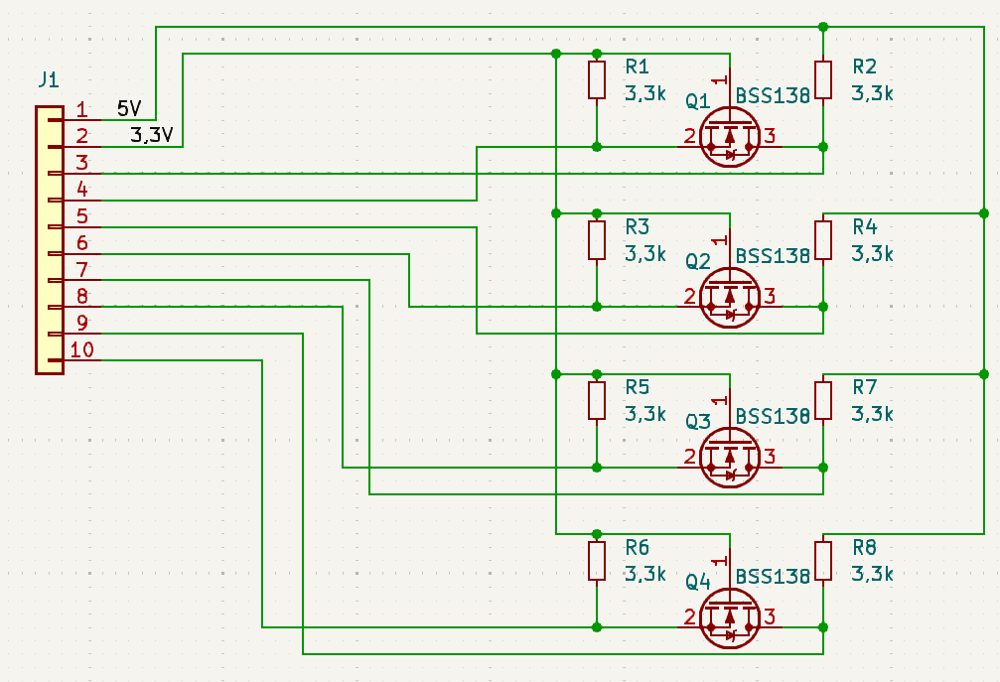
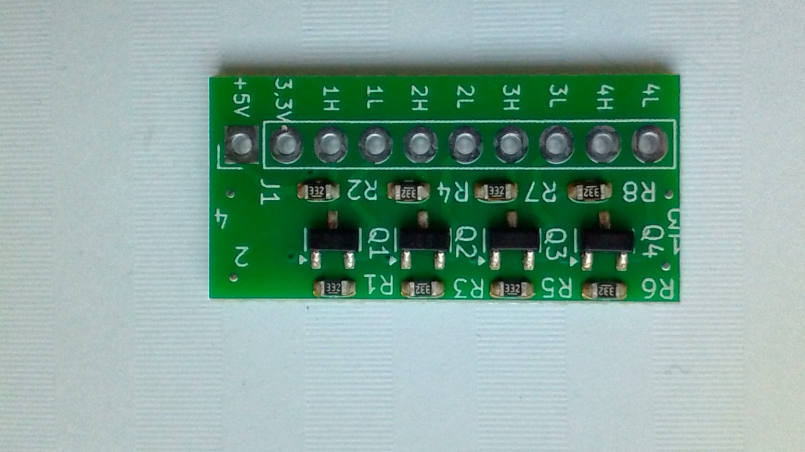
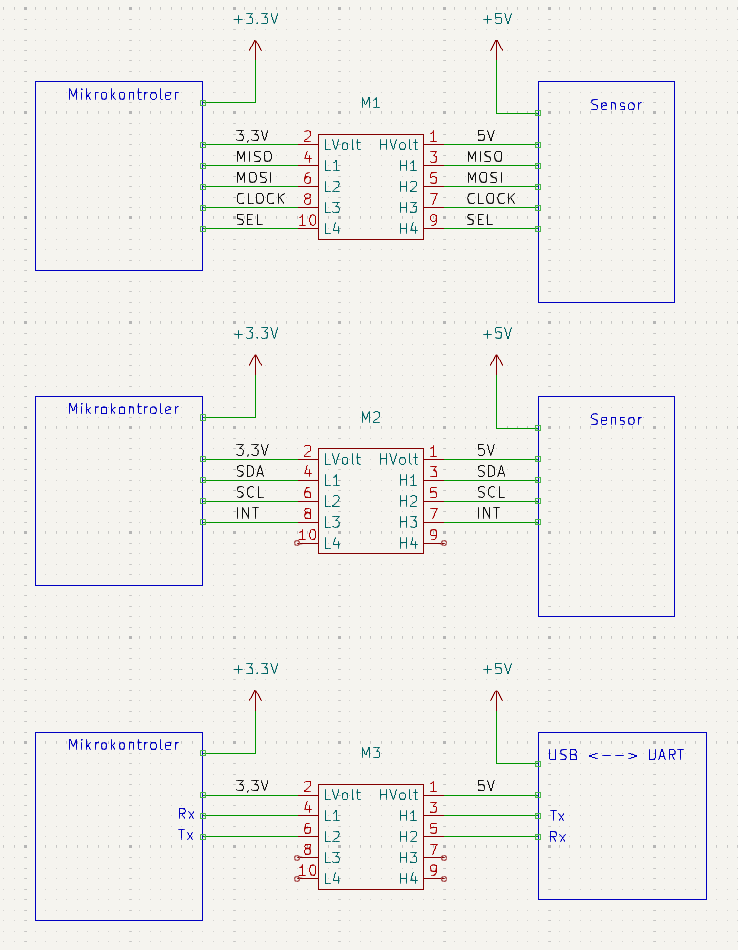

# LevelShiftMiniMax

The level shifter enables a microcontroller to interface with peripherals operating at a different voltage level.

It supports buses such as:

UART, I2C, SPI, and others.

Number of channels: 4.

All signals are located on one edge of the module, saving space on the target board. (MiniMax)

Schematic:   
<picture></picture>   
Real foto:   
<picture></picture>   
Examples of use.:   
<picture></picture>   

